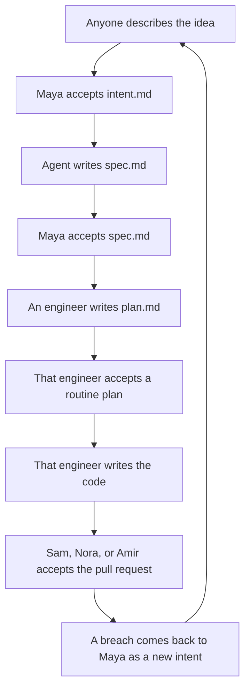

# sdlc-todo

A dummy TODO app for practicing the AI-native SDLC on one product. There is no application code yet. That is intentional.

Working notes for the playbook live in `.agents/references/ai-native-sdlc.md`. `AGENTS.md` and `CLAUDE.md` point agents there. The official article stays at [The AI-native SDLC playbook](https://claude.com/resources/articles/the-ai-native-sdlc-playbook).

## People

| Name | Role | Accepts | Question they answer |
| --- | --- | --- | --- |
| Maya Shah | Product manager | `intent.md`, then `spec.md` | Does this solve the right problem? |
| Leo Martins | Tech lead | A spec or plan classed as higher risk | Is this higher-risk change sound? |
| Sam Okonkwo | Engineer | His own routine `plan.md`, and a pull request he did not write | Does his plan prove the change, and does someone else's diff match the accepted plan? |
| Nora Berg | Engineer | Her own routine `plan.md`, and a pull request she did not write | Does her plan prove the change, and does someone else's diff match the accepted plan? |
| Amir Haddad | Engineer | His own routine `plan.md`, and a pull request he did not write | Does his plan prove the change, and does someone else's diff match the accepted plan? |

Maya owns the product decisions: the intent, and the spec. She consults Leo only when she classes a spec as higher risk. A routine plan stays with the engineer who wrote it. Leo accepts a plan only when the change is classed as higher risk. One person accepts each file. The other can comment, and does not add a second approval on the same file.

The playbook's definitions are in `.agents/references/ai-native-sdlc.md`. On this team they map like this.

| Playbook role | Who |
| --- | --- |
| Originator | Whoever has the idea |
| Product owner | Maya Shah |
| Technical lead | Leo Martins |
| Engineer | Sam Okonkwo, Nora Berg, Amir Haddad |
| Policy owner | Nobody named yet |
| Service owner | Nobody named yet |

A routine plan stays with the engineer who wrote it. Leo accepts a plan only when the change is classed as higher risk.

## Who does what

Today Maya asks for the spec after she accepts the intent. Later, that merge starts the draft on its own, and her first look is the spec review. That job does not exist yet. Leo joins a spec or a plan only when the change is classed as higher risk. The plan from the engineer's session is `plan.md`.

| Step | Drafted by | Accepted by |
| --- | --- | --- |
| Plan | The person with the idea | Maya |
| Design | The agent, from the accepted intent | Maya. Leo only if she classes it higher risk |
| Build | An engineer writes `plan.md`, then the code | That engineer, for a routine plan. Leo only when the change is classed as higher risk |
| Test and Deploy | The pull request | Sam, Nora, or Amir, if they did not write the change |
| Maintain | A breach, as a new intent | Maya, the same way as any other intent |

## One repo

Each change lives in `changes/NNN-short-name/`, starting with `intent.md`. `spec.md` and `plan.md` join that folder after their gates. Application code stays at the repo root. A second repo is for when one intent has to land in several products. This app is one product.

## What you do first

1. Describe the idea and ask for an intent. The `capture-intent` skill in `.agents/skills/capture-intent/` writes `changes/NNN-short-name/intent.md` from `references/TEMPLATE.md`.
2. The person who had the idea corrects anything the draft got wrong. The author and the time come from git history. The file has no status field.
3. Maya asks to see all intents, or all open intents. The `list-intents` skill in `.agents/skills/list-intents/` reads the pull requests and the default branch. She reviews one file with the `review-intent` skill in `.agents/skills/review-intent/`. She writes her answers into the file. Merging accepts it. Closing the review rejects it.
4. Maya opens a session on the accepted intent and asks for the spec. The `draft-spec` skill in `.agents/skills/draft-spec/` writes `changes/NNN-short-name/spec.md` and stops. She reviews that file with the `review-spec` skill in `.agents/skills/review-spec/`. She does not write it. Merging accepts it. Closing the review rejects it. Leo is consulted when she classes the change as higher risk. A merge-triggered spec job comes only after this hand pass.
5. An engineer picks up the accepted spec with the `build` skill in `.agents/skills/build/`. They accept their own routine plan before any application code is written. Leo accepts the plan only when the change is classed as higher risk. That session's plan is `plan.md`. The same skill then writes the code.
